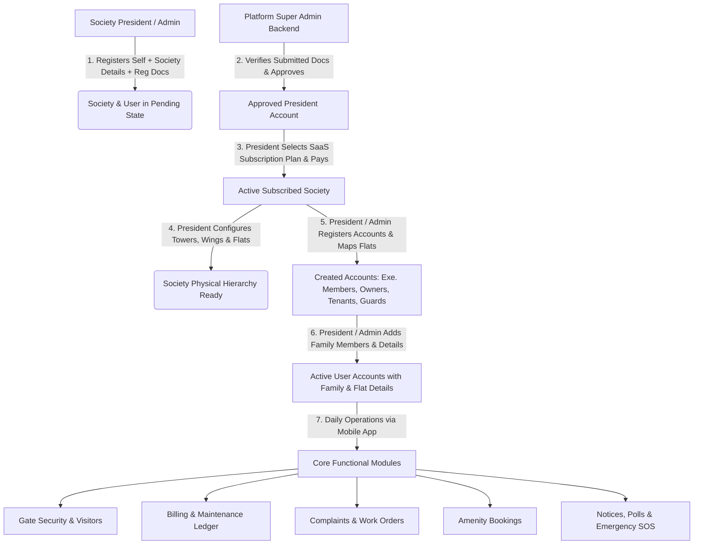
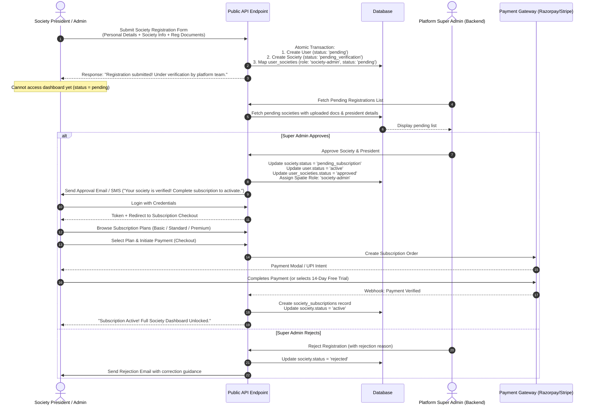
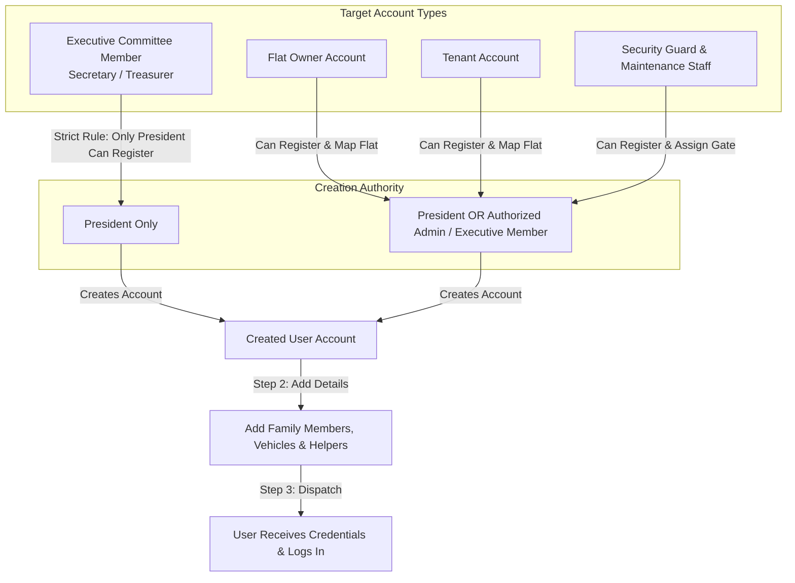
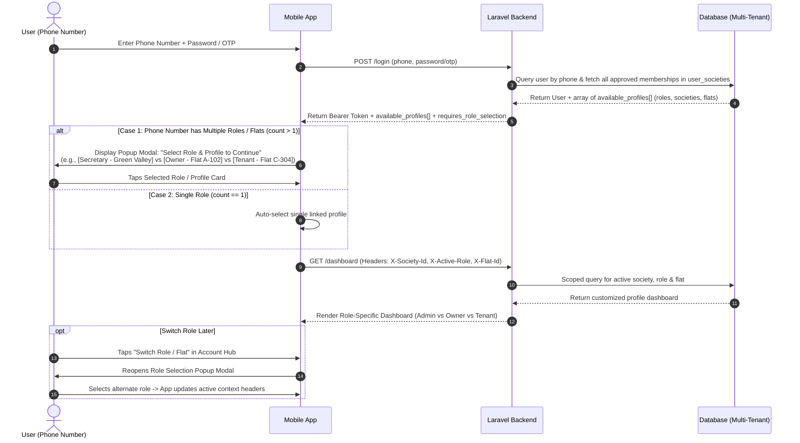
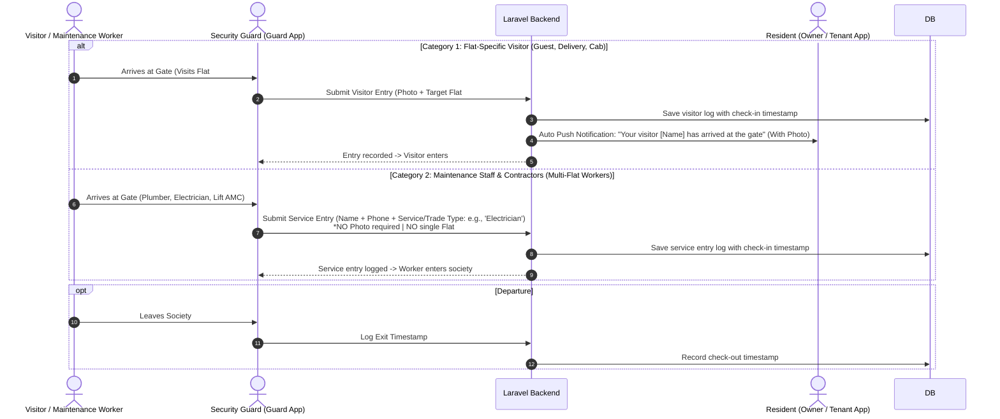
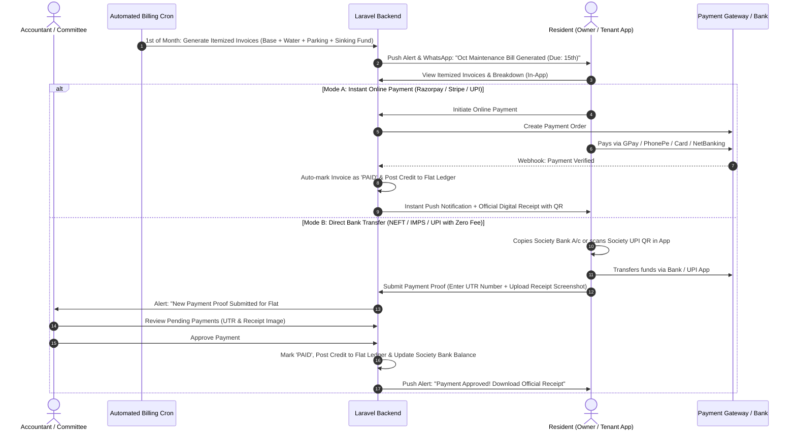
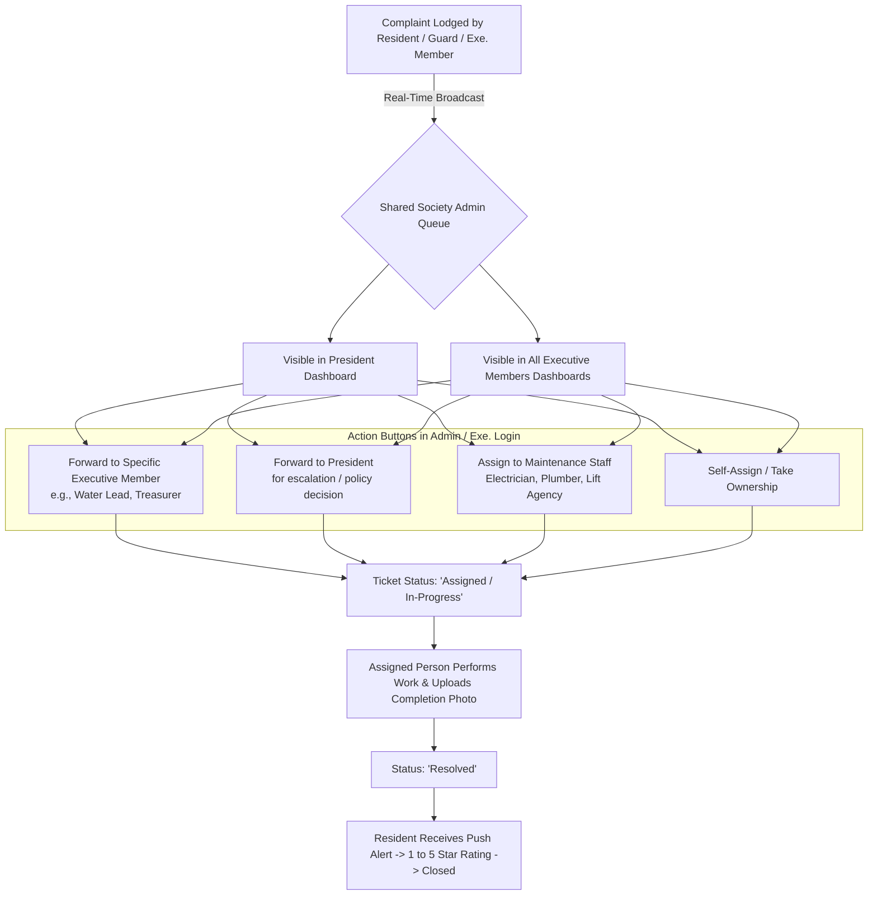
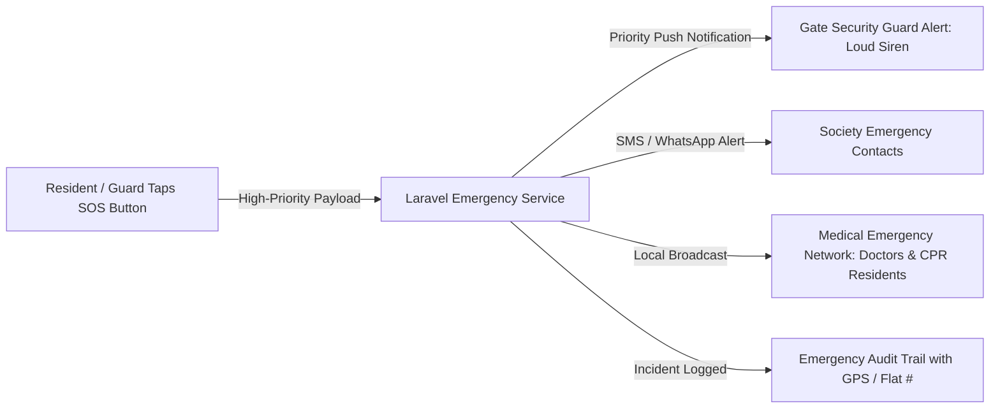

# Residential Society Management Platform - Visual System Diagrams

This document contains all the standalone **Mermaid Sequence Diagrams & Architectural Workflows** for the Residential Society Management Platform.

---

## 1. High-Level Platform Architecture

---

## 2. Phase 1: Society & President Onboarding Sequence

---

## 3. Phase 2: Centralized User Registration & Account Setup Authority Matrix

---

## 4. Phase 2: Login & Multi-Role / Multi-Society Selection Popup

---

## 5. Phase 3: Gate Security & Visitor Operations

---

## 6. Phase 4: Financial Accounting & In-App Maintenance Cost Collection

---

## 7. Phase 5: Grievance Routing & Committee Forwarding

---

## 8. Phase 7: Emergency SOS & Community Safety

